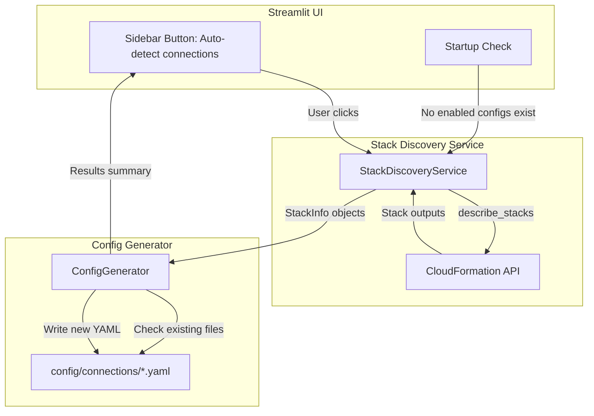

# Design Document: Auto-Populate Connectors

## Overview

This feature adds automatic connector configuration by querying deployed CloudFormation stacks and generating YAML config files for the connector framework. It introduces two new modules - `StackDiscoveryService` and `ConfigGenerator` - that bridge CloudFormation stack outputs to the existing `config/connections/*.yaml` convention.

The design prioritizes:
- **Zero-touch first run**: On startup with no existing configs, connectors are auto-populated
- **Safety**: Never overwrites manual configs; never stores plaintext credentials
- **Extensibility**: New stack types can be added by defining an output-mapping spec
- **Testability**: Pure-function config generation separated from AWS I/O

## Architecture



**Data Flow:**
1. Trigger (startup or button click) invokes `StackDiscoveryService`
2. Discovery service calls CloudFormation `describe_stacks` for each known stack name
3. For available stacks, outputs are extracted into `StackInfo` dataclasses
4. `ConfigGenerator` receives `StackInfo` objects and the config directory path
5. Generator checks for existing configs (by `type` field), skips if present
6. Generator writes new YAML files for unconfigured connector types
7. Results summary returned to UI for display

## Components and Interfaces

### StackDiscoveryService

**Location:** `src/llm_sql/connectors/stack_discovery.py`

```python
@dataclass
class StackInfo:
    """Represents a discovered CloudFormation stack and its extracted outputs."""
    stack_name: str
    stack_type: str  # 'main', 'rds', 'redshift'
    available: bool
    outputs: dict[str, str]  # output key -> value

class StackDiscoveryService:
    """Queries CloudFormation for known database stacks and extracts outputs."""

    def __init__(
        self,
        region: str | None = None,
        main_stack_name: str | None = None,
        rds_stack_name: str | None = None,
        redshift_stack_name: str | None = None,
    ):
        """Initialize with optional overrides; defaults from env vars."""

    def discover_all(self) -> list[StackInfo]:
        """Discover all known stacks and return their info."""

    def _describe_stack(self, stack_name: str) -> StackInfo | None:
        """Query a single stack. Returns None on API failure."""

    def _extract_outputs(self, stack: dict, stack_type: str) -> dict[str, str]:
        """Extract relevant output keys for the given stack type."""

    @staticmethod
    def is_available_status(status: str) -> bool:
        """Return True if the stack status indicates availability."""
```

### ConfigGenerator

**Location:** `src/llm_sql/connectors/config_generator.py`

```python
@dataclass
class GenerationResult:
    """Result of attempting to generate a connector config."""
    connector_type: str
    action: str  # 'created', 'skipped', 'unavailable', 'error'
    file_path: str | None = None
    reason: str | None = None

class ConfigGenerator:
    """Generates connector YAML configs from stack discovery results."""

    def __init__(self, config_dir: Path | None = None):
        """Initialize with target config directory."""

    def generate_all(self, stacks: list[StackInfo], region: str) -> list[GenerationResult]:
        """Generate configs for all discovered stacks. Skip existing."""

    def generate_athena_config(self, stack_info: StackInfo, region: str) -> dict:
        """Transform main stack outputs into Athena connector config dict."""

    def generate_rds_config(self, stack_info: StackInfo, region: str) -> dict:
        """Transform RDS stack outputs into RDS MySQL connector config dict."""

    def generate_redshift_config(self, stack_info: StackInfo, region: str) -> dict:
        """Transform Redshift stack outputs into Redshift connector config dict."""

    def _has_existing_config(self, connector_type: str) -> bool:
        """Check if a config with matching type field already exists."""

    @staticmethod
    def config_to_yaml(config: dict) -> str:
        """Serialize config dict to YAML string."""
```

### AutoPopulateOrchestrator

**Location:** `src/llm_sql/connectors/auto_populate.py`

```python
class AutoPopulateOrchestrator:
    """Coordinates discovery and generation. Used by Streamlit UI."""

    def __init__(self, config_dir: Path | None = None):
        """Initialize orchestrator."""

    def run(self) -> list[GenerationResult]:
        """Run full auto-populate: discover stacks, generate configs."""

    def should_auto_run(self) -> bool:
        """Return True if no enabled YAML configs exist (startup trigger)."""
```

### Streamlit Integration

**Location:** Added to `scripts/streamlit_app.py` sidebar rendering

The sidebar gains:
- An "Auto-detect connections" button below the connector picker
- On startup, calls `orchestrator.should_auto_run()` and triggers if True
- Displays results as a Streamlit info/success/warning banner

## Data Models

### StackInfo Dataclass

```python
@dataclass
class StackInfo:
    stack_name: str
    stack_type: str        # Literal['main', 'rds', 'redshift']
    available: bool
    outputs: dict[str, str]
```

### GenerationResult Dataclass

```python
@dataclass
class GenerationResult:
    connector_type: str    # 'athena', 'rds_mysql', 'redshift'
    action: str            # Literal['created', 'skipped', 'unavailable', 'error']
    file_path: str | None
    reason: str | None
```

### Generated YAML Structure (Athena Example)

```yaml
# Auto-generated by stack discovery
name: Athena (Auto-detected)
type: athena
enabled: true
settings:
  glue_db_names: "project_library_db,project_cars_db"
  s3_bucket: langchain-123456789012-eu-north-1
  workgroup: project-text-to-sql
  region: eu-north-1
```

### Generated YAML Structure (RDS MySQL Example)

```yaml
# Auto-generated by stack discovery
name: RDS Aurora MySQL (Auto-detected)
type: rds_mysql
enabled: true
settings:
  host: cgs-ai-rds-aurora-auroracluster-xxx.cluster-yyy.eu-north-1.rds.amazonaws.com
  port: 3306
  database: analyst_db
  user_from_secret: cgs-ai-rds-aurora/aurora-credentials
  region: eu-north-1
```

### Generated YAML Structure (Redshift Example)

```yaml
# Auto-generated by stack discovery
name: Redshift Serverless (Auto-detected)
type: redshift
enabled: true
settings:
  host: cgs-ai-redshift-serverless-wg.xxx.eu-north-1.redshift-serverless.amazonaws.com
  port: 5439
  database: analytics
  schema: public
  user_from_secret: cgs-ai-redshift-serverless/redshift-credentials
  region: eu-north-1
```

### Stack Output Key Mappings

| Stack Type | Output Key | Config Field |
|---|---|---|
| main | ProjectfilesBucketName | settings.s3_bucket |
| main | AthenaWorkgroupName | settings.workgroup |
| main | LibraryDatabaseName | settings.glue_db_names (part) |
| main | CarsDatabaseName | settings.glue_db_names (part) |
| rds | ClusterEndpoint | settings.host |
| rds | ClusterPort | settings.port |
| rds | DatabaseName | settings.database |
| rds | SecretName | settings.user_from_secret |
| redshift | RedshiftWorkgroupEndpoint | settings.host |
| redshift | RedshiftPort | settings.port |
| redshift | RedshiftDatabase | settings.database |
| redshift | ConnectionConfig | (parsed for secret name fallback) |

### Environment Variables

| Variable | Default | Purpose |
|---|---|---|
| AWS_REGION | eu-north-1 | Region for CloudFormation API calls |
| MAIN_STACK_NAME | cgs-ai-analyst-agent-project | Override main stack name |
| RDS_STACK_NAME | cgs-ai-rds-aurora | Override RDS stack name |
| REDSHIFT_STACK_NAME | cgs-ai-redshift-serverless | Override Redshift stack name |

## Correctness Properties

*A property is a characteristic or behavior that should hold true across all valid executions of a system - essentially, a formal statement about what the system should do. Properties serve as the bridge between human-readable specifications and machine-verifiable correctness guarantees.*

### Property 1: Stack status classification

*For any* CloudFormation stack status string, `is_available_status` SHALL return True if and only if the status is `CREATE_COMPLETE` or `UPDATE_COMPLETE`, and False for all other status values (including failed, deleted, in-progress, and rollback statuses).

**Validates: Requirements 1.2, 1.3**

### Property 2: Stack output extraction completeness

*For any* CloudFormation stack output dictionary and stack type, the extraction function SHALL return exactly the required output keys for that stack type when all are present, and SHALL return None (skip the stack) when any required key is missing.

**Validates: Requirements 2.1, 2.2, 2.3, 2.4**

### Property 3: Athena config generation correctness

*For any* valid main stack outputs (containing ProjectfilesBucketName, AthenaWorkgroupName, LibraryDatabaseName, CarsDatabaseName) and any valid AWS region string, the generated Athena config SHALL have type=athena, enabled=true, settings.s3_bucket equal to the ProjectfilesBucketName value, settings.workgroup equal to the AthenaWorkgroupName value, settings.glue_db_names containing all discovered database names as a comma-separated list, and settings.region equal to the provided region.

**Validates: Requirements 3.1, 3.2, 3.3, 3.4, 3.5, 3.6**

### Property 4: RDS config generation correctness

*For any* valid RDS stack outputs (containing ClusterEndpoint, ClusterPort, DatabaseName, SecretName) and any valid AWS region string, the generated RDS config SHALL have type=rds_mysql, enabled=true, and settings fields mapped exactly from the corresponding output values, with settings.region equal to the provided region.

**Validates: Requirements 4.1, 4.2, 4.3, 4.4, 4.5, 4.6, 4.7**

### Property 5: Redshift config generation correctness

*For any* valid Redshift stack outputs (containing RedshiftWorkgroupEndpoint, RedshiftDatabase, and a secret name) and any valid AWS region string, the generated Redshift config SHALL have type=redshift, enabled=true, settings.port=5439, settings.schema=public, and all other settings fields mapped from the corresponding output values, with settings.region equal to the provided region.

**Validates: Requirements 5.1, 5.2, 5.3, 5.4, 5.5, 5.6, 5.7, 5.8**

### Property 6: Existing config preservation

*For any* config directory containing YAML files with various `type` fields (both enabled and disabled), the Config_Generator SHALL never write a file for a connector type that already has a matching `type` field in any existing YAML file in the directory.

**Validates: Requirements 6.1, 6.2, 6.4**

### Property 7: Credential security invariant

*For any* set of stack outputs (regardless of their string content), the generated YAML config content SHALL never contain the substring of any Secrets Manager secret value, and SHALL only store Secrets Manager secret names (reference strings) in the `user_from_secret` field.

**Validates: Requirements 9.1, 9.2**

### Property 8: Configurable stack names with defaults

*For any* string value set as MAIN_STACK_NAME, RDS_STACK_NAME, or REDSHIFT_STACK_NAME environment variable, the Stack_Discovery_Service SHALL use that value as the stack name to query. When the environment variable is unset, it SHALL use the documented default value.

**Validates: Requirements 10.1, 10.2, 10.3**

## Error Handling

| Scenario | Behavior |
|---|---|
| CloudFormation API returns ClientError (AccessDenied) | Log warning, mark stack as unavailable, continue with other stacks |
| CloudFormation API returns ClientError (stack does not exist) | Mark stack as unavailable (expected case for undeployed stacks) |
| Network timeout calling CloudFormation | Log error, return empty result set |
| Stack exists but required output key missing | Log warning with stack name and missing key, skip that stack |
| Config directory does not exist | Create `config/connections/` directory before writing |
| YAML write fails (permission denied) | Log error, return GenerationResult with action='error' |
| Existing config file is malformed YAML | Treat as existing (do not overwrite), log warning |
| boto3 not available or not configured | Log error, return empty result set |

### Error Propagation Strategy

- **Stack Discovery**: Errors are caught per-stack. One stack failing does not prevent discovery of others.
- **Config Generation**: Errors are caught per-connector-type. One generation failure does not block others.
- **Orchestrator**: Never raises exceptions to the UI layer. Always returns a list of `GenerationResult` objects.
- **UI Layer**: Displays results based on `GenerationResult.action` field. Shows error details from `reason` field.

## Testing Strategy

### Unit Tests (Example-Based)

- `test_stack_discovery.py`: Mock boto3 CloudFormation client
  - Test successful stack discovery with valid outputs
  - Test handling of non-existent stacks (ClientError)
  - Test handling of stacks with failed status
  - Test missing output keys trigger skip
  - Test region from environment variable

- `test_config_generator.py`: Pure function tests
  - Test Athena config generation with known inputs
  - Test RDS config generation with known inputs
  - Test Redshift config generation with known inputs
  - Test skip behavior when config already exists
  - Test skip behavior when disabled config exists

- `test_auto_populate.py`: Orchestration tests
  - Test `should_auto_run` with empty directory
  - Test `should_auto_run` with existing configs
  - Test full run with mocked discovery

### Property-Based Tests (Hypothesis)

Property-based testing is applicable here because the Config Generator performs data transformations with clear input/output behavior across a large input space (arbitrary stack output strings).

**Library:** `hypothesis` (already in project dependencies)

**Configuration:**
- Minimum 100 iterations per property
- Each test tagged with: `Feature: auto-populate-connectors, Property {N}: {description}`

**Properties to implement:**
1. Stack status classification (Property 1)
2. Stack output extraction completeness (Property 2)
3. Athena config generation (Property 3)
4. RDS config generation (Property 4)
5. Redshift config generation (Property 5)
6. Existing config preservation (Property 6)
7. Credential security invariant (Property 7)
8. Configurable stack names with defaults (Property 8)

### Integration Tests

- Test with mocked boto3 to verify full orchestration flow
- Test YAML round-trip: generate config, load with `registry.py`, verify fields match
- Test Streamlit sidebar button triggers orchestration (manual/E2E)

### Test File Location

- `tests/test_stack_discovery.py`
- `tests/test_config_generator.py`
- `tests/test_auto_populate.py`
